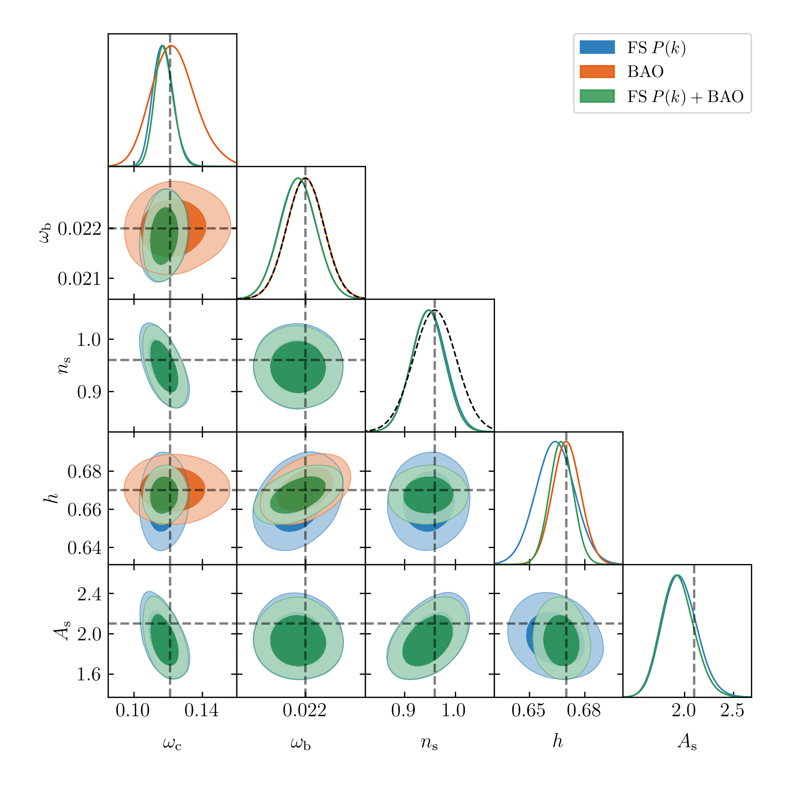

# cloechain

A YAML-driven configuration and sampler runner for
[`cloelike`](https://github.com/cloe-org/cloelike) likelihoods. Point it at a
config describing a probe, its data, scale cuts, fixed/sampled parameters and
a sampler, and it runs the sampler.

Currently supported:

- **Probes**:
  - `GCspectro_Pls` (`cloelike.EuclidLikelihood_GCspectro_Pls`, the
    full-shape power spectrum multipoles likelihood) —
    `examples/gcspectro_pls_nautilus.yaml`.
  - `GCspectro_BAO` (`cloelike.EuclidLikelihood_GCspectro_BAO`, BAO alphas) — `examples/gcspectro_bao_nautilus.yaml`.
  - `GCspectro_Pls_BAO` (`cloelike.EuclidLikelihood_GCspectro_Pls_BAO`, the
    joint full-shape + BAO likelihood) —
    `examples/gcspectro_pls_bao_nautilus.yaml`.
- **Sampler**: [`nautilus`](https://nautilus-sampler.readthedocs.io/).

Both are behind small lookup tables in `cloechain.loader` (`PROBES` /
`SAMPLERS`) — adding another probe or sampler is a new module plus one entry there, not a rewrite of the runner.

## Installation

`cloechain` depends on the latest versions of `cloelike`, `cloelib` and `euclidlib`, plus a number of external source libraries, including `COMET`, `PBJ`, `CAMB`, etc ...

## Usage

```bash
python -m cloechain --config examples/gcspectro_pls_nautilus.yaml
```

See `examples/gcspectro_pls_nautilus.yaml` for a full annotated example. 

## Output

A run writes two files to `output.directory`, both named after
`output.name`:

- **`<name>.npz`** — the chain itself, in the same format regardless of
  which sampler produced it (see `cloechain.chain.Chain`): a 2D `samples`
  array plus a `columns` list naming them, always
  `[logweight, loglikelihood, <parameter_1>, ..., <parameter_N>]`. Load it
  with `Chain.load(path)`, or read it directly with `numpy.load`.
- **`<name>.config.yaml`** — the exact YAML config used for the run    with a `software_versions` block appended recording the
  installed version of `cloechain`, `cloelike`, `cloelib`, `euclidlib`,
  `numpy` and `scipy` at run time, plus whichever packages this specific run actually depends on.

## Example output


